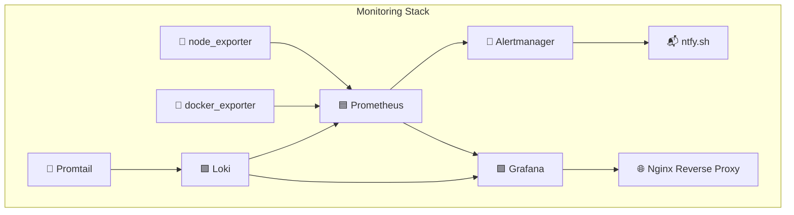

# nixos-hetzner-robot-starter

* Order a server on Hetzner Robot
    * For this tutorial, I am using an [AX41-NVMe](https://www.hetzner.com/dedicated-rootserver/ax41-nvme)
    * The `disk-config.nix` file sets software RAID 1 on the 2x 2TB NVMe SSDs (just as the delivered server has)

```
[bims@bims:~]$ lsblk -d -o NAME,MODEL,SIZE,TYPE,ROTA
NAME    MODEL                       SIZE TYPE ROTA
nvme0n1 SAMSUNG MZQL21T9HCJR-00A07  1.7T disk    0
nvme1n1 SAMSUNG MZQL21T9HCJR-00A07  1.7T disk    0
```


* Set your SSH public key in `robot.nix` and `linux.nix`
* Go through all the `FIXME:` notices in this repo and make changes wherever
  you want
* Make sure you have activated the [Hetzner Rescue System](https://docs.hetzner.com/robot/dedicated-server/troubleshooting/hetzner-rescue-system/) by enabling it and then doing an automated hardware reset on the Robot web console
* Run [`nixos-anywhere`](https://github.com/nix-community/nixos-anywhere)
  against `root@<server-ip-address>`
```bash
nix run github:numtide/nixos-anywhere -- --flake .#robot root@<server-ip-address>
```
* Wait for the installation to complete
* Try to SSH into the server with `ssh <your-username-selected-in-flake.nix>@<server-ip-address>`
* You'll probably receive an error like the one below; follow the steps to remove the ip address from `known_hosts`
```
  @@@@@@@@@@@@@@@@@@@@@@@@@@@@@@@@@@@@@@@@@@@@@@@@@@@@@@@@@@@
@    WARNING: REMOTE HOST IDENTIFICATION HAS CHANGED!     @
@@@@@@@@@@@@@@@@@@@@@@@@@@@@@@@@@@@@@@@@@@@@@@@@@@@@@@@@@@@
IT IS POSSIBLE THAT SOMEONE IS DOING SOMETHING NASTY!
Someone could be eavesdropping on you right now (man-in-the-middle attack)!
It is also possible that a host key has just been changed.
The fingerprint for the ED25519 key sent by the remote host is
XXXXXXXXXXXXXXXXXXXXXXXXXXXXXXXXXXXXXXXXXXX.
Please contact your system administrator.
Add correct host key in ~/.ssh/known_hosts to get rid of this message.
Offending ECDSA key in ~/.ssh/known_hosts:6
  remove with:
  ssh-keygen -f ~/.ssh/known_hosts" -R "<ip addrress>"
Host key for <ip_address> has changed and you have requested strict checking.
Host key verification failed.
```
* Now you can SSH into the server
* In a local terminal window, you can apply updated configurations to the remote server

There are two ways to do this:

### Directly on the server

```bash
sudo nixos-rebuild switch --flake ~/bims-nixos#robot
```

### From a remote client that has Nix available

🚩 Note: Currently only works if you have the same system architecture as the server.

```bash
nixos-rebuild switch --flake .#robot --target-host root@37.27.227.42 --build-host root@37.27.227.42 --use-remote-sudo
```

### Logging on to the server after installation

```
ssh bims@37.27.227.42
```

## Project Layout

In order to keep the template as approachable as possible for new NixOS users,
this project uses a flat layout without any nesting or modularization.

* `flake.nix` is where dependencies are specified
    * `nixpkgs` is the current release of NixOS
    * `disko` is used to prepare VM storage for NixOS
* `robot.nix` is where OpenSSH is configured and where the `root` SSH public
  key is set
* `linux.nix` is where the server is configured
    * The hostname is set here
    * The default shell is set here
    * User groups are set here
    * NixOS options are set here





## Hetzner Storage Box Setup with SSH Key Authentication on NixOS

This guide explains how to configure a Hetzner Storage Box to allow SSH access
from a NixOS server using a securely stored private key at
`/etc/keys/id_storagebox`.

---

### 1. Generate SSH Key

Run these commands on your NixOS server:

```bash
sudo mkdir -p /etc/keys
sudo ssh-keygen -t rsa -b 4096 -f /etc/keys/id_storagebox -N ""
sudo chmod 600 /etc/keys/id_storagebox
sudo chown root:root /etc/keys/id_storagebox
```

### 2. Upload Public Key to Storage Box

Hetzner requires a special method to install the SSH key using port 23 and a built-in helper.

Replace uXXXXX with your actual Storage Box ID:

```
cat /etc/keys/id_storagebox.pub | ssh -p 23 uXXXXX@uXXXXX.your-storagebox.de install-ssh-key
```

Do this from any other clients that need access to the storage box too (e.g. to
mirror the backups locally using restic)

